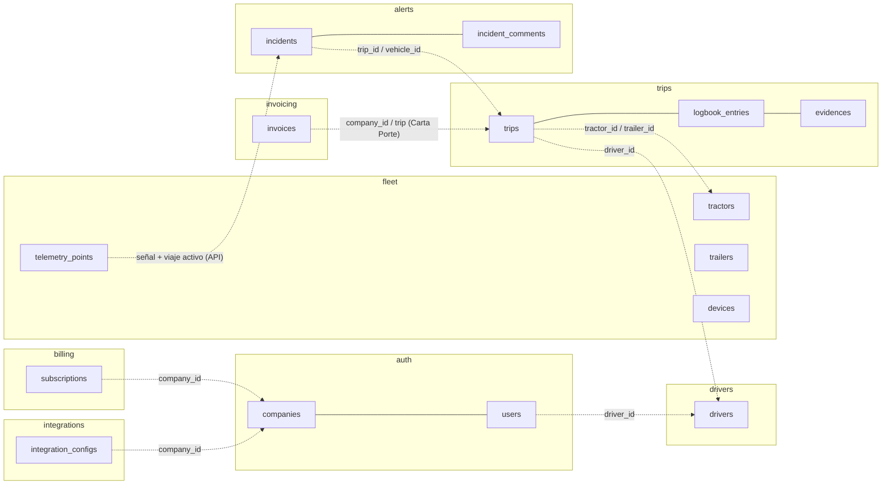

# Modelo de datos de G3

Base Postgres 16 (Cloud SQL) `g3` con **un schema por servicio** y un rol por servicio (`g3_<svc>`) que solo
accede a su schema. Redis (Memorystore) guarda solo estado efímero. Convenciones en
[`../PERSISTENCE-CONVENTIONS.md`](../PERSISTENCE-CONVENTIONS.md); roles y grants en
[`../../infra/db/init-schemas.sql`](../../infra/db/init-schemas.sql).

## Mapa de schemas

| Schema | Tablas | Detalle |
|---|---|---|
| `auth` | companies, users, mfa_factors, mfa_recovery_codes, security_policies, sso_configs, sso_config_domains, audit_chain_heads, audit_log | [auth.md](auth.md) |
| `billing` | subscriptions, stripe_webhook_events | [billing.md](billing.md) |
| `drivers` | drivers | [drivers.md](drivers.md) |
| `fleet` | tractors, trailers, devices, ingest_tokens, unknown_devices, telemetry_points (particionada por mes), vehicle_last_position | [fleet.md](fleet.md) |
| `trips` | trips, trip_folio_counters, logbook_entries, evidences, expense_policies | [trips.md](trips.md) |
| `alerts` | alerts, incidents, incident_folio_counters, incident_comments, alert_rules, notification_contacts, vehicle_last_signals | [alerts.md](alerts.md) |
| `integrations` | integration_configs (secretos cifrados AES-256-GCM, CHECK que impide texto en claro) | [integrations.md](integrations.md) |
| `invoicing` | invoices, invoice_stamp_attempts | [invoicing.md](invoicing.md) |

## Relaciones entre servicios

Las llaves foráneas solo existen **dentro** de un schema. Entre servicios, las referencias son ids de texto y la
consistencia se mantiene por API y por eventos, nunca con joins entre schemas.

`company_id` está en todas las tablas de negocio: es la frontera multi-tenant y el primer campo de los índices.

## Garantías de concurrencia (probadas contra Postgres real)

| Qué | Cómo |
|---|---|
| Folios de viaje e incidente únicos y consecutivos por compañía y año | Contador con `INSERT … ON CONFLICT DO UPDATE … RETURNING` en la transacción del alta, más `UNIQUE (company_id, folio)` |
| Reintentos de G3 Drive (cola offline) sin duplicados | `UNIQUE (company_id, client_uuid)` y `ON CONFLICT DO NOTHING` |
| Dos personas avanzan el mismo viaje o incidente | `UPDATE … WHERE status = <esperado>`: gana uno; el otro recibe un error de transición (409) |
| Pago al chofer liberado una sola vez | `UPDATE … WHERE payment_status = 'pending'` |
| Bitácora de auditoría íntegra | Hash encadenado con la cabeza bloqueada (`FOR UPDATE`) al anexar; triggers que rechazan UPDATE/DELETE/TRUNCATE y `REVOKE` al rol |
| Escalamiento de SLA con varias réplicas | Compare-and-set por nivel: solo la réplica que reclama notifica |
| Exceso de velocidad y GPS sin señal con varias réplicas | `client_uuid` determinista por unidad y ventana; el claim de la última señal se hace con `DELETE … WHERE recorded_at = …` |
| Telemetría duplicada | PK `(device_id, recorded_at)` en la tabla particionada e insert por lotes ordenados (sin deadlocks) |
| Timbrado de CFDI | `UNIQUE (company_id, idempotency_key)` y lease de 2 min: una sola llamada al PAC |
| Webhooks de Stripe | `stripe_webhook_events.event_id` como PK, con reclamo atómico |
| Límite de choferes del plan | Advisory lock por compañía al contar e insertar |

## Redis (estado efímero)

Retos MFA (intentos y uso único), `state`/nonce de SSO, códigos OTP y su límite de envíos, tokens de recuperación
de contraseña, rate limiting del gateway (ventana deslizante compartida entre réplicas) y el canal pub/sub
`g3:<env>:integrations:invalidate`. Perder Redis solo invalida sesiones en curso, nunca datos de negocio.

## Retención

- **Telemetría:** 13 meses (`TELEMETRY_RETENTION_MONTHS`). El job diario `g3-fleet-maintenance` crea las particiones
  futuras y borra las vencidas.
- **Auditoría:** append-only, sin borrado. El ancla del head en almacenamiento WORM está pendiente; ver
  `docs/ops/PRODUCTION-READINESS.md`.
- **Respaldos:** backups diarios de Cloud SQL con PITR (ver `docs/ops/RUNBOOK.md`).
