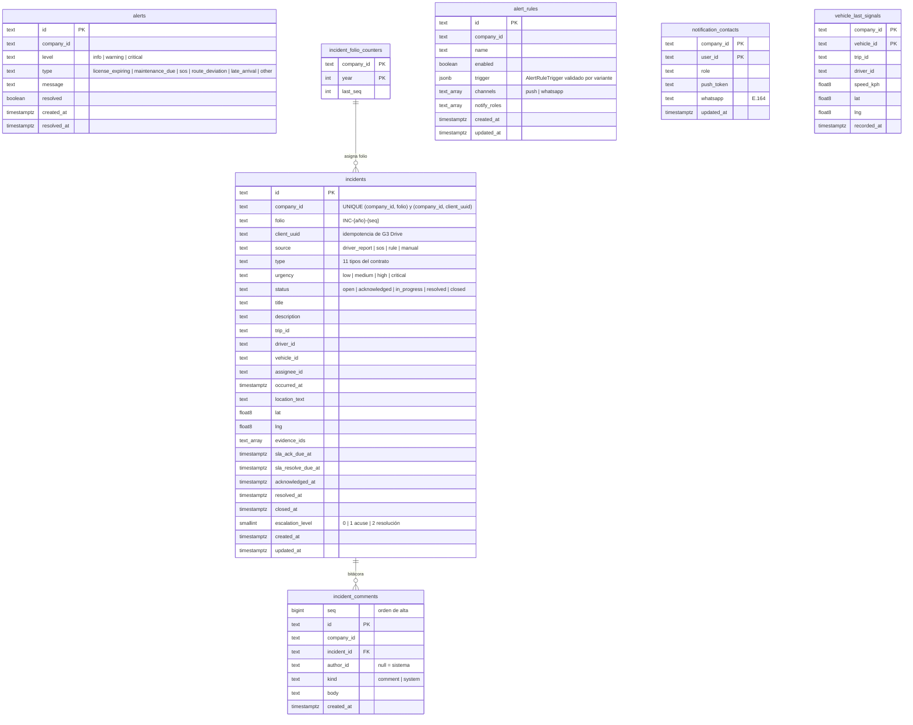

# Modelo de datos · alerts

Schema `alerts` (rol `g3_alerts`). Migraciones en `services/alerts/migrations/`; se aplican con
`node dist/migrate.js` (Cloud Run Job) o con `DB_MIGRATE_ON_BOOT=1` en desarrollo. Sin `DATABASE_URL`/`DB_HOST`
el servicio usa los repos en memoria (solo dev, una réplica).



`company_id` va en todas las tablas y abre todos los índices de negocio. Los ids de otros servicios
(`trip_id`, `driver_id`, `vehicle_id`, `assignee_id`, `evidence_ids`) no son FKs: viven en otros schemas y se
consultan por API.

## Decisiones

- **Folio único bajo concurrencia.** `incident_folio_counters` guarda el último consecutivo por compañía y año. El
  alta hace, en una sola transacción, `INSERT … ON CONFLICT (company_id, year) DO UPDATE SET last_seq = last_seq + 1
  RETURNING last_seq` (toma el bloqueo de la fila) y el `INSERT` del incidente. `UNIQUE (company_id, folio)` es la
  red de seguridad. Nunca se usa `count(*) + 1`.
- **Idempotencia de G3 Drive.** `UNIQUE (company_id, client_uuid)` con `ON CONFLICT DO NOTHING`. Si dos envíos de la
  cola offline llegan a la vez, el perdedor hace `ROLLBACK` (no consume folio), devuelve el incidente existente y no
  vuelve a notificar.
- **Enums.** `CHECK` idénticos a `contracts/src/dtos/incidents.ts` (`INCIDENT_TYPES`, `INCIDENT_URGENCIES`,
  `IncidentStatus`, `IncidentSource`) y a `AlertDto`.
- **Escalamiento seguro con varias instancias.** `runEscalations` lista los candidatos
  (`incidents_escalation_idx`, parcial sobre abiertos con nivel < 2) y reclama cada nivel con un compare-and-set:

  ```sql
  UPDATE incidents SET escalation_level = $n, updated_at = $now
   WHERE company_id = $1 AND id = $2 AND status NOT IN ('resolved','closed')
     AND escalation_level < $n AND <SLA de la etapa sigue vencido>
  RETURNING …
  ```

  Con `READ COMMITTED`, un segundo barrido simultáneo espera el bloqueo de la fila y vuelve a evaluar el `WHERE`
  sobre la versión nueva, así que recibe 0 filas y no notifica. Es equivalente a `FOR UPDATE SKIP LOCKED` por
  incidente, pero sin abrir una transacción durante el envío de notificaciones. Cada nivel se notifica una sola
  vez (idempotente por nivel). Si el proceso muere después de reclamar y antes de notificar, ese aviso se pierde;
  la bitácora del incidente lo deja ver. Se prefirió a notificar dos veces.
- **Regla `device_offline`.** La última posición por unidad con viaje activo ya no vive en un `Map` de la
  instancia. Ahora está en `vehicle_last_signals`, que se actualiza con un upsert que solo avanza en el tiempo
  (`WHERE recorded_at < excluded.recorded_at`). Una señal sin `tripId` borra la fila: la unidad ya no está en
  viaje. El barrido toma las filas viejas y reclama cada una con
  `DELETE … WHERE recorded_at = <la leída>`. Solo la instancia que borra abre el incidente, y si llegó una posición
  nueva entretanto, el reclamo falla. Se eligió Postgres y no Redis porque perder este estado apaga en silencio
  una alerta de seguridad (GPS inhibido en un robo). La carga es un upsert por posición sobre una fila por unidad.
- **Reglas.** `trigger` es `jsonb` con un `CHECK` por variante: `minUrgency` válida, `stage` ack/resolve,
  `thresholdKph` numérico en (0, 200) y `minutes` numérico en [5, 1440]. `channels` debe ser un subconjunto de
  push/whatsapp. La API valida lo mismo antes (`validateRule`).
- **Contactos.** La PK es `(company_id, user_id)` y `whatsapp` lleva un `CHECK` E.164. En el upsert, un campo
  ausente conserva el valor y `null` lo borra.
- **Transiciones.** Se actualizan con `WHERE status = <leído>` (control optimista). Si otro operador cambió el
  estado, la API responde 409 en vez de pisarlo. La evidencia se agrega con un `array_append` condicionado, que es
  atómico y no duplica.
- **Comentarios.** `seq` (identity) da el orden estable aunque varias entradas de sistema compartan `created_at`.

## Pendiente

- Velocidad (`speeding`): solo hay un incidente cada 30 min por unidad, y se revisa leyendo. Dos réplicas que
  reciben señales de la misma unidad en el mismo instante podrían abrir dos. Si pasa, conviene un
  `setIfAbsent` en Redis por unidad.
- Retención: purgar `incident_comments` e incidentes cerrados según la política de datos.
