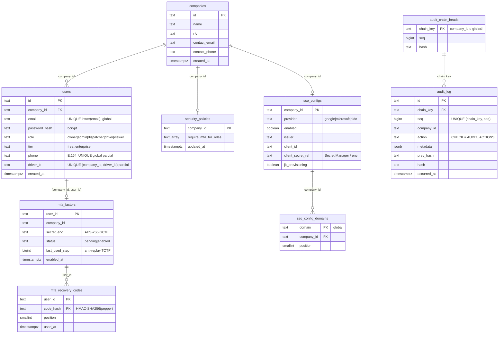

# Modelo de datos · auth

Schema `auth` (rol `g3_auth`). Migraciones: `services/auth/migrations/`. Cada repo en memoria tiene su gemelo en
Postgres con la misma interfaz:

| Interfaz | Memoria | Postgres |
| --- | --- | --- |
| `UserRepo`, `CompanyRepo` | `repos/in-memory.*.repo.ts` | `repos/pg.user.repo.ts` |
| `AuditRepo` | `audit/audit.repo.ts` | `audit/pg.audit.repo.ts` |
| `MfaRepo`, `SecurityPolicyRepo`, `SsoConfigRepo` | `mfa/mfa.repo.ts`, `security/security-policy.ts`, `sso/sso.repos.ts` | `repos/pg.security.repos.ts` |

El estado efímero (retos MFA, `state` SSO, OTP, enlaces de recuperación) **no** está en Postgres: va a Redis por
`EphemeralStore` (ver al final).



## Tablas

### `companies`

Datos de registro de la compañía (tenant). `id` es el `company_id` de todo el sistema.

### `users`

| Columna | Notas |
| --- | --- |
| `email` | Único **global** sin distinguir mayúsculas (`users_email_uq` sobre `lower(email)`): el login es por correo. Los choferes sin correo reciben uno sintético `<tel>@drive.g3.local`. |
| `phone` | E.164 (`CHECK`), único global cuando existe: el OTP de G3 Drive identifica al chofer por teléfono. |
| `driver_id` | Registro en el servicio `drivers` (claim `driverId`). Sin FK (otro schema). Único por compañía. |
| `role` | `CHECK` idéntico a `UserRole`. |
| `tier` | Copia del plan para emitir el JWT (`updateTierForCompany` la actualiza cuando billing emite `subscription.*`). La fuente de verdad es billing. |
| `users_company_id_uq (company_id, id)` | Destino de FKs compuestas: `mfa_factors` no puede apuntar a un usuario de otra compañía. |

**Errores de dominio:** un `23505` se traduce a `DuplicateUserError` (`AuthError` 409) según la restricción:
`users_email_uq` → "Ese correo ya existe en G3", `users_phone_uq` → "Ese teléfono ya tiene acceso a G3",
`users_company_driver_uq` → "Ese chofer ya tiene acceso a G3". FK inexistente (`23503`) y `CHECK` (`23514`) → 400.
El repo en memoria aplica las mismas unicidades.

### `mfa_factors` y `mfa_recovery_codes`

- El secreto TOTP se guarda cifrado (`secret_enc`, AES-256-GCM con `MFA_ENCRYPTION_KEY`); nunca en claro.
- `status`: `pending` (enrolamiento iniciado) o `enabled`; `CHECK` amarra `enabled_at` al estado.
- **Anti-replay TOTP atómico:** `advanceStep` hace
  `UPDATE … SET last_used_step = $step WHERE status = 'enabled' AND (last_used_step IS NULL OR last_used_step < $step)`.
  Dos peticiones simultáneas (en réplicas distintas) con el mismo código: solo una actualiza la fila. Vive en
  Postgres y no en Redis a propósito: es durable y no se pierde si Redis se vacía.
- Códigos de recuperación: solo `HMAC-SHA256(MFA_RECOVERY_PEPPER, código)`; uso único con
  `UPDATE … SET used_at = … WHERE used_at IS NULL` (`markRecoveryCodeUsed`). `position` conserva el orden.
- `company_id` se toma del usuario al insertar (`INSERT … SELECT … FROM users`), con FK compuesta.

### `security_policies`

Una fila por compañía; `require_mfa_for_roles text[]` con `CHECK (… <@ ARRAY[roles])`. Sin fila = política por
defecto (`MFA_MANDATORY_ROLES`).

### `sso_configs` y `sso_config_domains`

- `client_secret_ref` solo admite referencias (`projects/…/secrets/…` o `env:VAR`), nunca el secreto: `CHECK` con la
  misma expresión que el servicio.
- `sso_config_domains.domain` es PK **global**: un dominio de correo pertenece a una sola compañía. Si otra compañía
  lo intenta registrar, el `23505` se traduce a 409 "El dominio … ya está asociado a otra compañía" (el servicio ya lo
  valida; la PK lo garantiza bajo concurrencia).
- `save` reemplaza la config y sus dominios en una transacción.

### `audit_log` y `audit_chain_heads` — bitácora append-only con hash encadenado

```
hash_n     = sha256(prev_hash_n + JSON canónico(entrada_n sin hash))
prev_hash_n = hash_{n-1}        (génesis = '0' × 64)
```

- Una cadena por compañía (`chain_key = company_id`) y una global (`'__global__'`, `company_id NULL`) para eventos
  sin compañía resoluble. `CHECK` amarra `chain_key` con `company_id`.
- **Consistencia bajo concurrencia:** `PgAuditRepo.appendNext` corre en una transacción:
  1. `INSERT INTO audit_chain_heads … ON CONFLICT DO NOTHING` (crea la cabeza en `seq = 0` la primera vez);
  2. `SELECT seq, hash … FOR UPDATE` — bloquea la cabeza: los anexos de la misma cadena se serializan entre todas
     las réplicas; cadenas distintas no se bloquean entre sí;
  3. calcula `seq + 1`, `prev_hash` y `hash`, inserta en `audit_log` y avanza la cabeza.
  `UNIQUE (chain_key, seq)` es la red de seguridad. Probado con 20 anexos en paralelo y con 30 desde dos pools
  distintos (dos "réplicas"): `verify` da `ok`.
- **Append-only en la base:** el trigger `audit_log_no_update_delete` (BEFORE UPDATE OR DELETE, por fila) y
  `audit_log_no_truncate` rechazan con `42501`, aun para el dueño de la tabla. `audit_chain_heads_guard` impide
  borrar una cabeza o moverla de otra forma que `seq + 1` (borrarla permitiría reiniciar una cadena).
- **Permisos:** además del trigger, el rol de la app no debe tener `UPDATE/DELETE/TRUNCATE`:
  `REVOKE UPDATE, DELETE, TRUNCATE ON auth.audit_log FROM g3_auth;` La migración lo ejecuta si el rol `g3_auth`
  existe y no es quien corre la migración. Recomendado: migrar con un rol dueño (`g3_auth_migrator`) y que la app
  corra como `g3_auth` con solo `SELECT, INSERT` sobre `audit_log`.
- `metadata` es `jsonb`: el orden de llaves no importa porque el hash usa JSON canónico (llaves ordenadas).
  Postgres no admite `U+0000` en `text/jsonb`, así que `AuditService` lo elimina **antes** de calcular el hash.
- `occurred_at` es el `timestamp` del DTO (precisión de milisegundos, entra al hash).
- `action` tiene `CHECK` idéntico a `AUDIT_ACTIONS`: agregar una acción al contrato exige una migración nueva (hay un
  test que inserta todas las de `@g3/contracts`).
- Índices: `(chain_key, seq)` (verificación y paginado), `(chain_key, action, seq DESC)`,
  `(chain_key, actor_user_id, seq DESC)` y `(company_id, occurred_at DESC)` para los filtros de la bitácora.
- Límite conocido: quien controle toda la base puede reescribir la cadena completa; para detectarlo el `head` debe
  anclarse fuera (bucket WORM).

## Estado efímero (Redis, `EphemeralStore`)

Llaves con prefijo `g3:<G3_ENV>:auth:` (lo pone el store). En dev/tests, `MemoryEphemeralStore` con el reloj
inyectado.

| Llave | Contenido | TTL | Operación atómica |
| --- | --- | --- | --- |
| `mfa:challenge:<jti>` | userId del reto vigente | 5 min | `take` (GETDEL) al consumir: un solo uso entre réplicas |
| `mfa:attempts:<jti>` | fallos del reto | 5 min | `incr`; con 5 → 429 |
| `mfa:used:<jti>` | marca de consumido (mensaje "ya usado") | 5 min | `set` |
| `sso:state:<state>` | `{companyId, nonce, codeVerifier, createdAtMs}` | 10 min | `take` en el callback |
| `otp:requests:<tel>` | ventana deslizante de envíos | 15 min | `slidingHit` (Lua): máx. 3 |
| `otp:code:<tel>` | `{userId, codeHash, expiresAt}` (sha256 con pepper, nunca el código) | 5 min | `take` al validar |
| `otp:attempts:<tel>` | intentos del código vigente | vida del código | `incr` **antes** de comparar: intentos en paralelo no rebasan 5 |
| `pwreset:<sha256(token)>` | `{userId, expiresAt}` | 30 min | `take`: un solo uso |

## Operación

- `node dist/migrate.js` aplica las migraciones y termina (Cloud Run Job). `DB_MIGRATE_ON_BOOT=1` en dev.
- `/health` (liveness) y `/ready` (Postgres y Redis).
- En producción `assertProductionEnv` exige `DATABASE_URL` (o `DB_HOST`) y `REDIS_URL`.
