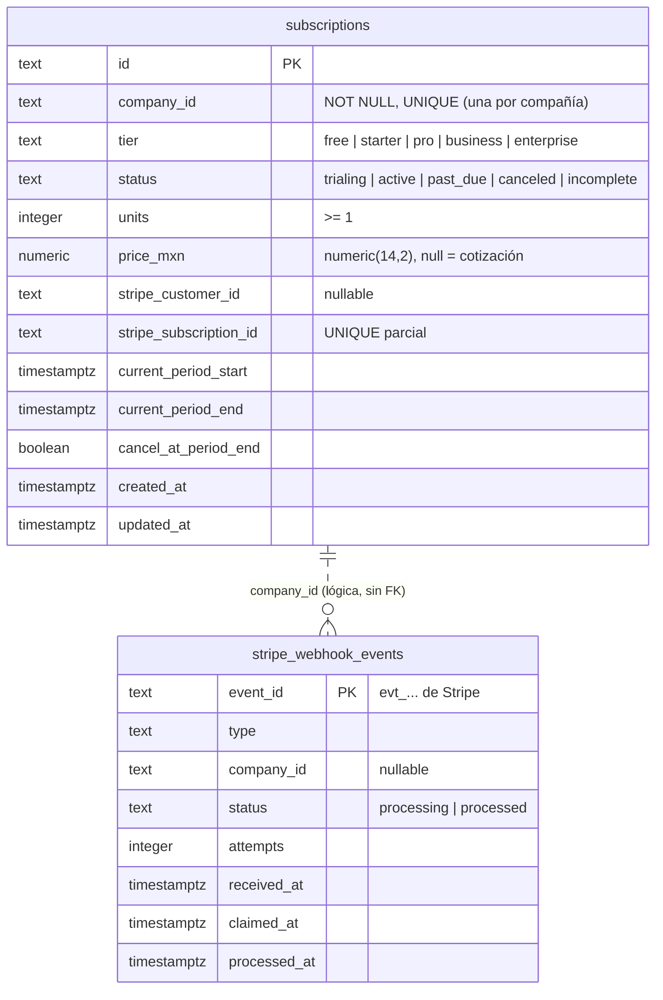

# Modelo de datos · billing

Schema `billing` (rol `g3_billing`). Migraciones: `services/billing/migrations/`. Interfaces en
`src/repos/subscription.repo.ts`; implementaciones en memoria (`in-memory.subscription.repo.ts`) y Postgres
(`pg.subscription.repo.ts`).

## `subscriptions`

Suscripción vigente de cada compañía; el historial de cambios vive en los eventos del bus
(`subscription.upgraded/downgraded/...`).

| Columna | Tipo | Notas |
| --- | --- | --- |
| `id` | `text` PK | uuid v4. Se conserva en los upserts. |
| `company_id` | `text NOT NULL` | `UNIQUE`: una suscripción por compañía (`save` es upsert por esta llave). |
| `tier` | `text` | `CHECK` idéntico a `TierValue` de `@g3/contracts`. |
| `status` | `text` | `CHECK` idéntico a `SubscriptionDto['status']`. |
| `units` | `integer` | Unidades contratadas, `>= 1`. |
| `price_mxn` | `numeric(14,2)` | Dinero según la convención; `null` = enterprise (cotización). Se lee con `num()`. |
| `stripe_customer_id` | `text` | Reservado para el adaptador real de Stripe (aún no lo llena la API). |
| `stripe_subscription_id` | `text` | Único cuando existe: una suscripción de Stripe no puede quedar en dos compañías (`23505` → 409). |
| `current_period_start/end` | `timestamptz` | Periodo de facturación; `CHECK end >= start`. |
| `cancel_at_period_end` | `boolean` | Cancelación programada. |

Índices: `subscriptions_stripe_sub_uq` (parcial, búsqueda desde el webhook), `subscriptions_stripe_customer_idx`
(parcial) y `subscriptions_period_end_idx` (renovaciones/vencimientos).

## `stripe_webhook_events`

Idempotencia de webhooks: Stripe entrega *al menos una vez* y reintenta, a veces en paralelo. La llave es el
`event.id` de Stripe.

| Columna | Notas |
| --- | --- |
| `event_id` | PK. |
| `status` | `processing` (reclamado por una réplica) o `processed` (efectos aplicados). `CHECK` amarra `processed_at`. |
| `attempts` | Cuántas veces se reclamó (re-reclamos tras una réplica caída). |
| `claimed_at` | Para detectar reclamos abandonados (> 5 min). |

Flujo (`BillingService.applyStripeEvent`, usado por `POST /subscriptions/apply-tier` cuando trae `eventId`):

1. `claim`: un solo `INSERT … ON CONFLICT (event_id) DO UPDATE … WHERE status = 'processing' AND claimed_at < now() - 5 min
   RETURNING`. Solo una réplica obtiene `claimed`; las demás ven `processed` o `in_progress` y responden con la
   suscripción vigente sin repetir efectos ni eventos.
2. Se aplica el tier (upsert de `subscriptions`).
3. `complete` marca `processed`. Si algo falla, `release` borra el reclamo para que el reintento de Stripe lo procese.

`startTrial` usa `insertIfAbsent` (`INSERT … ON CONFLICT (company_id) DO NOTHING RETURNING` + `SELECT`) y solo la
llamada que crea publica `subscription.started`.

## Operación

- `node dist/migrate.js` (Cloud Run Job) o `DB_MIGRATE_ON_BOOT=1` en dev.
- `/health` y `/ready` (ping a la base).
- La llamada a `integrations` (credenciales de Stripe) usa `serviceFetchFromEnv()` (`x-internal-token` y, con
  `SERVICE_AUTH=gcp`, ID token de Cloud Run).
