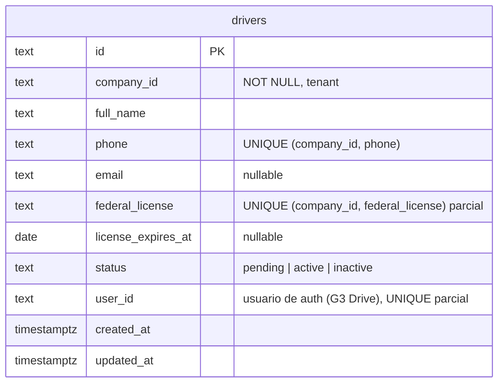

# Modelo de datos · drivers

Schema `drivers` (rol `g3_drivers`). Migraciones: `services/drivers/migrations/`. Repos: `InMemoryDriverRepo`
(dev/tests) y `PgDriverRepo` (Postgres) con la misma interfaz `DriverRepo` (`src/driver.repo.ts`).

## `drivers`

| Columna | Tipo | Notas |
| --- | --- | --- |
| `id` | `text` PK | uuid v4 generado por la app. |
| `company_id` | `text NOT NULL` | Tenant. Toda consulta filtra por él. |
| `full_name` | `text` | 1–200 caracteres. |
| `phone` | `text NOT NULL` | Único por compañía (el OTP de G3 Drive identifica al chofer por teléfono). |
| `email` | `text` | Opcional; `CHECK` de forma mínima. |
| `federal_license` | `text` | Licencia federal SICT. Única por compañía cuando existe. |
| `license_expires_at` | `date` | Día calendario de vencimiento. La API lo devuelve como `YYYY-MM-DD` (un ISO con hora se trunca al día). |
| `status` | `text` | `CHECK (status IN ('pending','active','inactive'))`, idéntico a `DriverDto['status']`. |
| `user_id` | `text` | Usuario de auth vinculado (G3 Drive). Sin FK: vive en otro schema. Único por compañía. |
| `created_at`, `updated_at` | `timestamptz` | `updated_at` lo fija cada `UPDATE` del repo. |

### Índices y por qué

| Índice | Uso |
| --- | --- |
| `drivers_company_created_idx (company_id, created_at, id)` | `GET /drivers` en orden de alta. |
| `drivers_company_phone_uq` | Unicidad de teléfono por compañía. |
| `drivers_company_license_uq` (parcial) | Unicidad de licencia cuando se capturó. |
| `drivers_company_user_uq` (parcial) | Un usuario de G3 Drive ↔ un chofer. |
| `drivers_company_license_exp_idx` (parcial) | Alertas `license_expiring` sobre choferes no inactivos. |

## Reglas que viven en el repo

- **Errores de dominio, no 500:** un `23505` se traduce a `DriverConflictError` (HTTP 409) indicando el campo
  (`phone`, `federalLicense`, `userId`); fechas inválidas (`22007/22008`) y `CHECK` (`23514`) a 400.
- **Límite del plan atómico:** `createWithinLimit` cuenta e inserta dentro de una transacción con
  `pg_advisory_xact_lock(hashtextextended('drivers:' || company_id, 0))`, así dos altas simultáneas no rebasan el
  límite de `TIER_LIMITS[tier].users`. El repo en memoria lo hace sin `await` entre conteo e inserción.
- `update` solo toca `full_name, phone, email, federal_license, license_expires_at, status`; nunca `id` ni
  `company_id`.

## Operación

- `node dist/migrate.js` aplica las migraciones y termina (Cloud Run Job). `DB_MIGRATE_ON_BOOT=1` las aplica al
  arrancar (dev).
- `/health` (liveness) y `/ready` (ping a la base).
