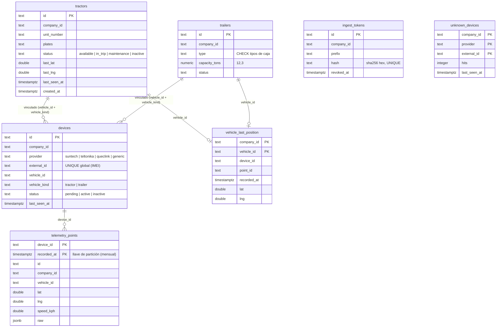

# Modelo de datos · fleet

Schema `fleet` (rol `g3_fleet`). Migraciones en `services/fleet/migrations/`, repos Postgres en
`services/fleet/src/pg.repos.ts` y contratos en `src/repos.ts`. Los repos en memoria (`src/in-memory.repos.ts`,
`src/telemetry/in-memory.telemetry.repos.ts`) cumplen la misma interfaz, y `test/repos.contract.spec.ts` corre los
mismos casos contra los dos. Flujo de ingesta: `docs/TELEMETRY-INGESTION.md`.



## Tablas

| Tabla | Qué guarda | Llaves y restricciones |
|---|---|---|
| `tractors`, `trailers` | Unidades (`TractorDto`, `TrailerDto`) | PK `id`; `CHECK status` y `type` iguales a los DTO |
| `devices` | Equipos GPS y su vínculo a un vehículo | `UNIQUE (external_id)` **global a propósito** (el IMEI enruta la telemetría a una sola compañía); `CHECK (vehicle_id IS NULL) = (vehicle_kind IS NULL)` |
| `ingest_tokens` | Tokens del webhook por compañía | Solo se guarda el `sha256` en hex (`CHECK ~ '^[0-9a-f]{64}$'`, `UNIQUE`); `revoked_at` no nulo = revocado |
| `unknown_devices` | IMEIs que reportaron sin estar dados de alta (onboarding) | PK `(company_id, provider, external_id)`; upsert `hits = hits + 1` |
| `telemetry_points` | Todos los puntos GPS. **Particionada por mes** | PK `(device_id, recorded_at)` = idempotencia |
| `vehicle_last_position` | La última posición por vehículo (mapa en vivo) | PK `(company_id, vehicle_id)` |

`telemetry_points` no tiene FK a `devices`: al borrar un equipo se conserva su historial, y la ingesta no paga una
verificación por fila. Los ids son uuid v4, así que un `device_id` no se reutiliza.

## Telemetría de alto volumen

### Escritura por lotes

Cada request de ingesta escribe **un solo `INSERT` multi-fila** (en trozos de 1 000 filas, 17 parámetros por fila):

```sql
WITH ins AS (
  INSERT INTO telemetry_points (...) VALUES (...), (...), ...
  ON CONFLICT (device_id, recorded_at) DO NOTHING
  RETURNING *
), latest AS (
  INSERT INTO vehicle_last_position (...)
  SELECT DISTINCT ON (company_id, vehicle_id) ... FROM ins
   WHERE vehicle_id IS NOT NULL ORDER BY company_id, vehicle_id, recorded_at DESC
  ON CONFLICT (company_id, vehicle_id) DO UPDATE SET ...
  WHERE vehicle_last_position.recorded_at < EXCLUDED.recorded_at
)
SELECT id FROM ins;
```

- **Dedupe.** Un `(device_id, recorded_at)` repetido, dentro del lote o contra lo ya guardado, no se inserta. Los ids
  que devuelve `RETURNING` dicen qué puntos entraron; los demás cuentan como `duplicates` en `IngestResultDto`.
- **Última posición monotónica.** Del lote solo se usa el punto más nuevo de cada vehículo, y el upsert solo pisa la
  fila si ese punto es más reciente. Los puntos atrasados (buffer del equipo) se guardan en el historial, pero no
  mueven el mapa.
- **Sin deadlocks.** El lote se ordena por `(device_id, recorded_at)` antes de insertar. Así dos webhooks con los
  mismos puntos en distinto orden no se esperan mutuamente.
- Después del insert, el servicio hace un `UPDATE` por equipo (`markSeen`: de `pending` a `active` y
  `last_seen_at = GREATEST(...)`) y uno por tracto (`touchPosition`, que solo avanza si el punto es más nuevo), en
  lugar de uno por punto.

### Particionamiento

- `PARTITION BY RANGE (recorded_at)`, una partición por mes **en UTC**: `telemetry_points_pYYYYMM` con
  `FROM ('YYYY-MM-01 00:00:00+00') TO (mes siguiente)`. Los límites no dependen del `TimeZone` de la sesión.
- El índice `telemetry_points_vehicle_idx (company_id, vehicle_id, recorded_at DESC)` se propaga a cada partición. Lo
  usan el recorrido (`listByVehicle`, con poda de particiones por rango) y los conteos. La PK sirve para las
  consultas por equipo.
- Funciones en el schema (con `SET search_path FROM CURRENT`):
  - `telemetry_ensure_partition(ts)` crea la partición del mes de `ts` si no existe. Toma un advisory lock por schema
    y tolera que otra instancia la haya creado primero.
  - `telemetry_ensure_partitions(desde, hasta)` crea las particiones de cada mes del rango.
  - `telemetry_drop_partitions_before(ts)` hace `DROP` de las particiones de meses anteriores al de `ts` y devuelve
    sus nombres.
- **Las particiones se crean automáticamente en tres momentos:**
  1. La migración `0001` crea el mes anterior, el actual y los 3 siguientes.
  2. Al arrancar, el servicio llama a `PgTelemetryRepo.ensureWindow()` (misma ventana). Si falla, solo deja un aviso
     en el log.
  3. En la ingesta, si un punto cae en un mes que la instancia no tiene en su caché (por ejemplo un buffer viejo o un
     reloj adelantado), se llama a `telemetry_ensure_partition` antes del `INSERT`. Cada mes cuesta una llamada por
     instancia.
- No hay partición `DEFAULT`, a propósito. Si existiera y recibiera filas, después no se podría crear la partición
  de ese mes sin moverlas.
- Alternativa evaluada: `pg_partman`. Hace lo mismo con `run_maintenance()`, pero en Cloud SQL requiere habilitar la
  extensión y su background worker. Con las tres funciones de arriba basta.

### Retención

- **13 meses** por defecto (`TELEMETRY_RETENTION_MONTHS`; `0` desactiva el borrado). Cubre un año completo más el
  mes en curso, que es lo que piden las comparaciones año contra año.
- `node dist/maintenance.js` (`npm run maintenance`) asegura la ventana de particiones y luego borra con `DROP TABLE`
  las particiones cuyo mes es anterior al corte (inicio del mes en curso menos N meses). `DROP` no genera bloat ni
  requiere `VACUUM`, a diferencia de un `DELETE` masivo.
- **En producción:** un Cloud Run Job `g3-fleet-maintenance` disparado a diario por Cloud Scheduler. Es idempotente.
  Si una auditoría exige conservar más tiempo, primero se exporta la partición (`COPY` o export de Cloud SQL a GCS) y
  después se borra.

## Ingest tokens

Se guarda el `sha256` del token, nunca el secreto. `listActive()` lee todos los vigentes (índice parcial
`WHERE revoked_at IS NULL`) y el servicio compara cada hash con `timingSafeEqual` sin salida anticipada. La
revocación conserva la primera fecha (`COALESCE(revoked_at, $3)`). Con muchas compañías conviene el formato
`g3it_<id>.<secreto>` para buscar por id (ver TELEMETRY-INGESTION.md).

## Índices

| Índice | Para qué |
|---|---|
| `tractors_company_idx`, `trailers_company_idx`, `devices_company_idx` `(company_id, created_at)` | Listados por compañía |
| `devices_external_id_uq (external_id)` | Resolver el IMEI en la ingesta (búsqueda global) |
| `devices_company_vehicle_idx (company_id, vehicle_id)` parcial | Equipos de un vehículo |
| `ingest_tokens_company_idx`, `ingest_tokens_active_idx` parcial | Gestión de tokens y autenticación del webhook |
| `telemetry_points` PK `(device_id, recorded_at)` | Idempotencia e historial por equipo |
| `telemetry_points_vehicle_idx (company_id, vehicle_id, recorded_at DESC)` | Recorrido y conteos por vehículo |
| `vehicle_last_position` PK `(company_id, vehicle_id)` | Mapa en vivo (`lastByVehicles` con `vehicle_id = ANY($2)`: una consulta) |

## Caché del viaje activo

`HttpActiveTripResolver` (fleet → trips) guarda la respuesta 60 s **en memoria, por instancia**, a propósito y no en
Redis. Es una caché corta y acotada (10 000 entradas) que solo ahorra llamadas durante las ráfagas de posiciones del
mismo vehículo. Si dos réplicas tienen valores distintos por unos segundos no pasa nada: la señal sale con o sin
viaje, y alerts lo tolera. Compartirla costaría un viaje de red por punto, que es justo lo que la caché evita.

## Operación

- `node dist/migrate.js` (Cloud Run Job antes del deploy) o `DB_MIGRATE_ON_BOOT=1` en desarrollo.
- `node dist/maintenance.js`: particiones y retención (job diario).
- Sin `DATABASE_URL`/`DB_HOST` el servicio usa memoria (solo desarrollo). En producción falla al arrancar.
- `/health` (liveness) y `/ready` (hace ping a la DB). Al recibir SIGTERM se cierra Nest, se esperan las señales en
  vuelo hacia alerts (`IncidentSignalBus.drain`) y se cierra el pool.
