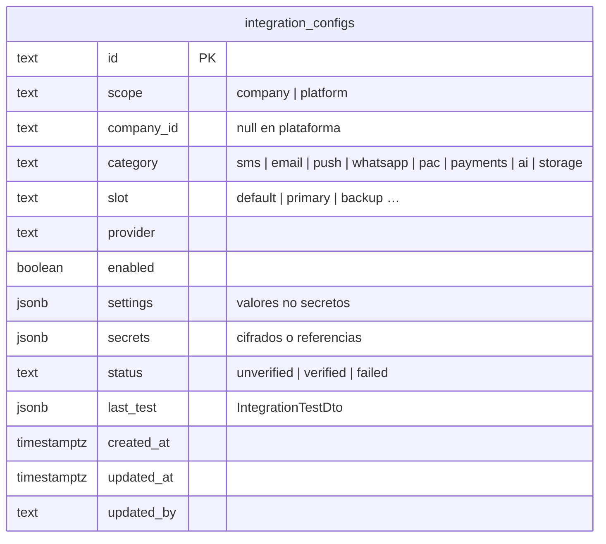

# Modelo de datos · integrations

Schema `integrations` (rol `g3_integrations`). Migraciones en `services/integrations/migrations/`, aplicadas con
`node dist/migrate.js` o `DB_MIGRATE_ON_BOOT=1`. Sin base configurada se usa `InMemoryIntegrationRepo` (solo dev).

## Decisiones

- **Unicidad.** Hay una configuración por destino:
  `UNIQUE INDEX (scope, coalesce(company_id, ''), category, slot)`. El `coalesce` es necesario porque en un `UNIQUE`
  `NULL ≠ NULL`, y sin él se podrían repetir configuraciones de plataforma. El upsert usa ese mismo índice
  (`ON CONFLICT (scope, (coalesce(company_id,'')), category, slot)`) y conserva `id` y `created_at`.
- **Alcance coherente.** `CHECK ((scope = 'platform') = (company_id IS NULL))`.
- **Secretos.** Se guardan como los deja el servicio y la base nunca los descifra:
  - **Literal:** `{ storage: 'encrypted', ciphertext: 'v1.<iv>.<tag>.<ct>', hint }`. Va cifrado con AES-256-GCM y
    `INTEGRATIONS_ENCRYPTION_KEY`. El AAD (alcance|compañía|categoría|ranura|proveedor|campo) liga el ciphertext a
    su fila: copiado a otra compañía, no se descifra.
  - **Referencia:** `{ storage: 'secret_manager', ref: 'gsm:…' }` o `{ storage: 'env', ref: 'env:…' }`.

  Como defensa en profundidad, `integration_configs_secrets_ck` (con `jsonb_path_exists`) rechaza cualquier secreto
  que no tenga una de esas tres formas. Un valor en claro no entra a la tabla aunque haya un bug en el servicio.
  Un test lo verifica con una consulta cruda.
- **Multi-tenant.** Es la excepción a `company_id NOT NULL`: la plataforma es la configuración de respaldo de todas
  las compañías. Toda consulta filtra por `(scope, coalesce(company_id,''))`.
- **Invalidación de cachés.** Después de guardar o borrar, el servicio publica `{ scope, companyId, category, slot }`
  en Redis (`g3:<G3_ENV>:integrations:invalidate`). Ver [INTEGRATIONS.md](../INTEGRATIONS.md#caché-e-invalidación).
