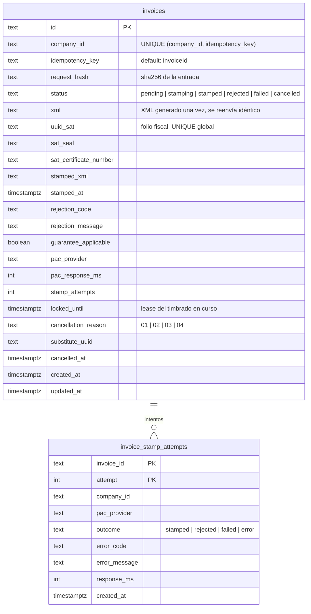

# Modelo de datos · invoicing

Schema `invoicing` (rol `g3_invoicing`). Migraciones en `services/invoicing/migrations/` (`node dist/migrate.js` o
`DB_MIGRATE_ON_BOOT=1`).

Invoicing todavía no expone HTTP propio: es una librería de dominio (generador CFDI/Carta Porte, PACs y
`InvoiceService`). Esta migración agrega **solo lo necesario para que el timbrado sea idempotente y auditable**.
`src/runtime.ts` (`invoicingRuntimeFromEnv`) arma el repo y el PAC por compañía para quien lo hospede.



## Flujo idempotente (`InvoiceService` con `repo`)

```
stamp(companyId, idempotencyKey = invoiceId, input)
  ├─ existe la llave → ¿mismo request_hash? no → 409
  │                   stamped/rejected/cancelled → devuelve lo guardado (sin PAC)
  ├─ no existe → valida y genera el XML → INSERT pending (ON CONFLICT DO NOTHING; el perdedor lee el existente)
  ├─ claimStamp: UPDATE … SET status='stamping', stamp_attempts+1, locked_until=now+2 min
  │      WHERE status IN ('pending','failed') OR (status='stamping' AND locked_until <= now)
  │      └─ nadie más lo tiene → otra instancia recibe `in_progress`
  ├─ PAC.stamp(xml guardado)
  └─ completeStamp (transacción): bitácora del intento + resultado
         stamped → siempre se guarda · rejected (SAT) → definitivo · failed/error → reintentable
```

## Decisiones

- **Una llave, un comprobante.** `UNIQUE (company_id, idempotency_key)`. Una entrada distinta con la misma llave es
  un error (409), no un timbrado nuevo.
- **El XML se genera una sola vez.** Regenerarlo cambia `Fecha` y el sello, y el PAC lo trataría como otro CFDI.
  Un reintento después de un timeout reenvía el mismo XML. Si el primer intento sí llegó al SAT, el PAC responde
  "ya timbrado" (307) con el timbre existente y no emite otro UUID.
- **`uuid_sat` único en todo el país** (índice parcial cuando no es null). `CHECK`: `stamped`/`cancelled` siempre
  tienen UUID.
- **Lease en lugar de bloqueo largo.** No se mantiene una transacción abierta durante la llamada al PAC (hasta
  30 s). Si la instancia muere, otra retoma el timbrado al vencer `locked_until`. Un fallo tardío de un intento
  vencido no pisa al intento vigente. Un timbre exitoso tardío sí se guarda, porque el UUID ya existe en el SAT.
- **Rechazo del SAT vs. error nuestro.** Un rechazo con `isOurError: false` es definitivo y queda en `rejected`.
  Uno con `isOurError: true` o una excepción queda en `failed` (reintentable), con `guarantee_applicable`.
- **XML como `text`.** En V1 va en la fila (10–40 KB). Si el volumen crece, una migración nueva agrega
  `stamped_xml_uri` (Cloud Storage) y mueve el contenido.
- **PAC usado e intentos.** `pac_provider` y `stamp_attempts` guardan el último intento. `invoice_stamp_attempts`
  guarda todos (failover de `HighAvailabilityPacProvider`: `diverza+facturama`).

## Pendiente

- Servicio HTTP de invoicing (o módulo hospedado en billing) que llame a `invoicingRuntimeFromEnv()` y exponga
  timbrado y cancelación. Hasta entonces, el repo queda listo pero nadie lo usa en producción.
