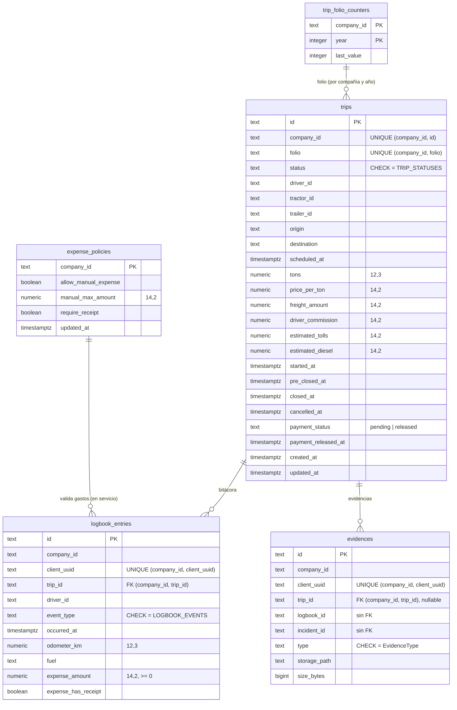

# Modelo de datos · trips

Schema `trips` (rol `g3_trips`). Migraciones en `services/trips/migrations/`, repos Postgres en
`services/trips/src/pg.repos.ts` y contratos en `src/repos.ts`. Los repos en memoria
(`in-memory.trip.repo.ts`, `in-memory.ops.repo.ts`) cumplen la misma interfaz, y
`test/repos.contract.spec.ts` corre los mismos casos contra los dos.

## Tablas

| Tabla | Qué guarda | Llaves y restricciones |
|---|---|---|
| `trips` | El viaje (`TripDto`) con montos, estampas por estado y el pago al chofer | PK `id`; `UNIQUE (company_id, id)` para las FK compuestas; `UNIQUE (company_id, folio)`; `CHECK status` igual a `TRIP_STATUSES` de `contracts/src/trip-status.ts`; `CHECK payment_status IN ('pending','released')` |
| `trip_folio_counters` | El último consecutivo de folio por compañía y año | PK `(company_id, year)` |
| `logbook_entries` | La bitácora del chofer (G3 Drive), con los gastos | `UNIQUE (company_id, client_uuid)`; FK `(company_id, trip_id)` → `trips`; `CHECK event_type`, `fuel` y `expense_amount >= 0` |
| `evidences` | Metadatos de los archivos en Cloud Storage (bucket privado) | `UNIQUE (company_id, client_uuid)`; FK `(company_id, trip_id)` → `trips`; `CHECK type` |
| `expense_policies` | La política de gastos de la compañía (una fila por compañía) | PK `company_id` |

Las FK compuestas `(company_id, trip_id)` impiden que una fila apunte a un viaje de otra compañía, aunque el servicio
también lo valida. `logbook_id` e `incident_id` de `evidences` no tienen FK: la cola offline de Drive puede subir la
evidencia antes que su asiento, y los incidentes viven en otro servicio (alerts).

## Decisiones

- **Vocabulario único de estados.** El `CHECK` de `trips.status` repite literalmente `TRIP_STATUSES`. Si el contrato
  cambia, se agrega una migración que reemplaza el `CHECK`. Los estados heredados (`paid`, `delivered`, `finished`…)
  se traducen antes con `fromLegacyTripStatus`. El pago no es un estado: va en `payment_status`.
- **Folio seguro bajo concurrencia.** `PgTripRepo.nextFolioSeq` hace un solo
  `INSERT … ON CONFLICT (company_id, year) DO UPDATE SET last_value = last_value + 1 RETURNING last_value`, que bloquea
  la fila del contador hasta el commit. Nunca se usa `count(*) + 1`. El folio es `G3-<año UTC>-<5 dígitos>` y el
  contador vuelve a empezar cada año. Si el alta falla después de pedir el número, ese folio queda sin usar: puede
  haber huecos, pero nunca repetidos (además lo garantiza `UNIQUE (company_id, folio)`). El test "30 altas
  concurrentes" lo comprueba en memoria y en Postgres.
- **Transiciones sin carreras.** `setStatus` valida `canTransition` y luego escribe con
  `UPDATE … WHERE company_id = $1 AND id = $2 AND status = $actual RETURNING *`. Si otro request movió el viaje entre
  la lectura y la escritura, no se actualiza ninguna fila y el servicio responde
  `Transición inválida: <estado real> → <destino>`. Con dos avances simultáneos, uno gana y el otro recibe el error.
  La liberación del pago funciona igual (`… AND payment_status = 'pending' AND status = ANY(pagables)`), así un pago
  no se libera dos veces.
- **Idempotencia de G3 Drive.** La bitácora y las evidencias se dan de alta con
  `INSERT … ON CONFLICT (company_id, client_uuid) DO NOTHING RETURNING *` y, si hubo conflicto, `SELECT` de la fila
  existente. Si dos reintentos llegan a la vez, ambos reciben la misma fila y el evento `trip.logbook_entry_added`
  sale una sola vez.
- **Montos y fechas.** El dinero es `numeric(14,2)` (`price_per_ton` también), las toneladas y el odómetro son
  `numeric(12,3)` y las coordenadas `double precision`. pg devuelve `numeric` como string y el repo lo convierte con
  `num()`. Las fechas son `timestamptz` y el servicio normaliza `scheduledAt`/`estimatedUnloadAt` a ISO UTC en el
  alta (rechaza fechas inválidas), así memoria y Postgres devuelven lo mismo.
- **Límite del plan (`tripsPerMonth`).** Se cuenta con `count(*)` sobre
  `COALESCE(scheduled_at, started_at, now())` dentro del mes UTC, con la misma regla que en memoria. Esta verificación
  no es transaccional: dos altas simultáneas en el borde del límite pueden pasar ambas. Se acepta porque es un límite
  comercial, no de integridad.

## Índices

| Índice | Para qué |
|---|---|
| `trips_company_status_idx (company_id, status, updated_at DESC)` | Listados de la torre de control por estado |
| `trips_company_driver_idx (company_id, driver_id, status)` parcial | `GET /trips/mine` y listados por chofer |
| `trips_company_refdate_idx (company_id, COALESCE(scheduled_at, started_at, created_at) DESC)` | Reporte de rentabilidad por periodo (misma expresión que `tripReferenceDate`) |
| `trips_company_tractor_refdate_idx (company_id, tractor_id, <fecha ref> DESC)` parcial | Reporte filtrado por tracto |
| `trips_active_tractor_idx` / `trips_active_trailer_idx` parciales (estados activos) | `GET /trips/internal/active-by-vehicle/:id` (fleet → alerts) |
| `logbook_company_trip_idx (company_id, trip_id, occurred_at)` | Bitácora de un viaje y `listByTrips` (`trip_id = ANY($2)`) del reporte |
| `evidences_company_trip_idx (company_id, trip_id, created_at DESC)` | Evidencias de un viaje |

**El reporte de rentabilidad hace dos consultas, sin importar cuántos viajes incluya:** `listForReport` (filtros y
orden en SQL: fecha de referencia desc, desempate por `id COLLATE "C"`) y `listByTrips` (toda la bitácora de esos
viajes con una sola consulta). El test de contrato compara el reporte completo de memoria contra el de Postgres.

## Operación

- `node dist/migrate.js` (Cloud Run Job antes del deploy) o `DB_MIGRATE_ON_BOOT=1` en desarrollo.
- Sin `DATABASE_URL`/`DB_HOST` el servicio usa memoria (solo desarrollo). En producción falla al arrancar.
- `/health` (liveness) y `/ready` (hace ping a la DB). El apagado ordenado cierra Nest y luego el pool.
